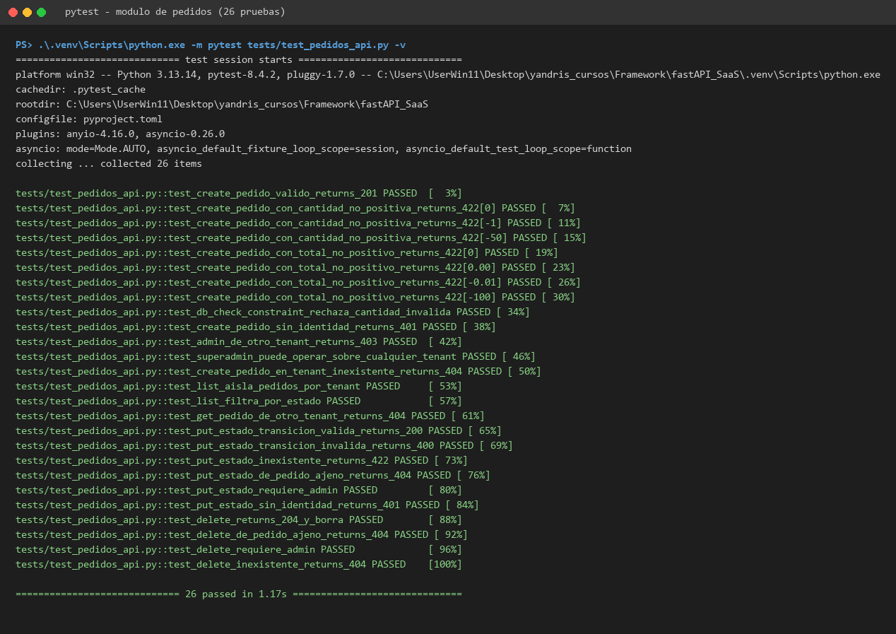
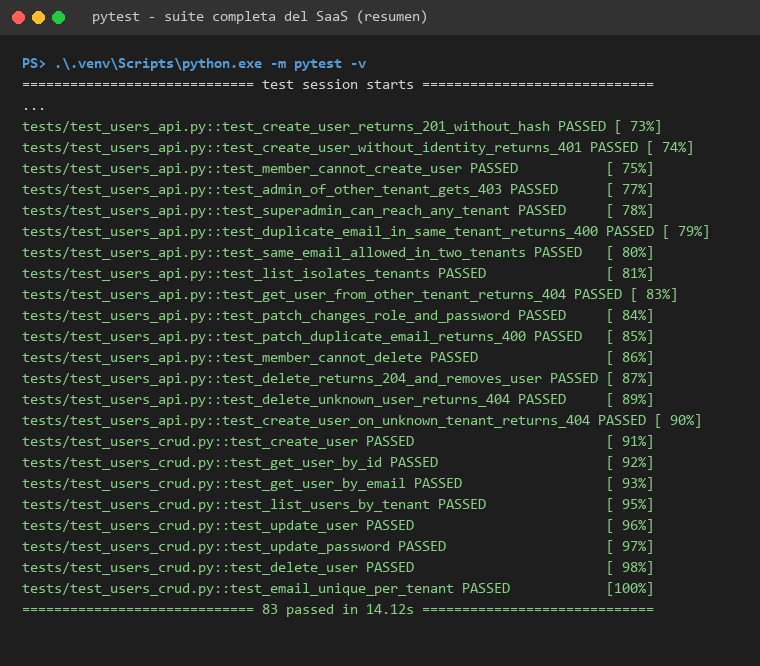
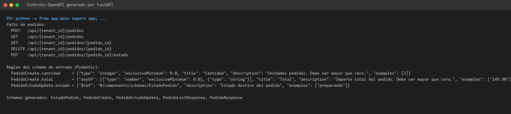

# Actividad AA1-5 — Comparación MVC clásico, MVT y API-First

**Rama:** `yandris-rivera/AA1-5` · **Servicio:** `fastAPI_SaaS` · **Fecha:** 2026-11-17

## 1. Qué se implementó

Módulo de pedidos multi-tenant con validación en el borde y aislamiento por tienda:

| Método | Ruta | Regla |
|---|---|---|
| `POST` | `/api/{tenant_id}/pedidos` | Pydantic rechaza `cantidad <= 0` y `total <= 0` (422) |
| `GET` | `/api/{tenant_id}/pedidos` | Lista solo pedidos del tenant (paginado, filtro por estado) |
| `GET` | `/api/{tenant_id}/pedidos/{pedido_id}` | 404 si el pedido es de otro tenant |
| `PUT` | `/api/{tenant_id}/pedidos/{pedido_id}/estado` | Máquina de estados: 400 si la transición es inválida |
| `DELETE` | `/api/{tenant_id}/pedidos/{pedido_id}` | 204; 404 si es de otro tenant; 403 si no es admin |

El aislamiento se aplica en tres niveles: `require_tenant_scope` (403), filtro `tenant_id` en cada query (404) y política RLS de Postgres con `app.current_tenant` (fail closed). La regla de negocio aparece además como `CHECK` en la migración `0005_pedidos`: aunque alguien escriba por fuera de la API, la BD no acepta la fila.

## 2. Tabla comparativa

| Criterio | MVC clásico | MVT (Django) | API-First (FastAPI) |
|---|---|---|---|
| Unidad de organización | Controlador + vista + modelo | Modelo + Template + View | Recurso + schema + ruta |
| Entrada del usuario | Formulario HTML | Template renderizado en servidor | JSON sobre HTTP |
| Validación | Manual en el controlador o en el modelo | `forms.Form` / `ModelForm` | Pydantic v2 en el borde |
| Contrato de la API | Implícito, acoplado a la vista | Implícito, acoplado al template | OpenAPI generado automáticamente |
| Respuesta | HTML | HTML | JSON |
| Aislamiento multi-tenant | Filtro manual en cada consulta | Filtro manual o manager custom | Dependencia + RLS en la BD |
| Testabilidad | Requiere el framework web | Requiere el framework web | `ASGITransport` in-process, sin servidor |
| Acoplamiento | Vista ↔ modelo ↔ ORM | Template ↔ modelo ↔ ORM | Router ↔ schema ↔ servicio; dominio reutilizable |
| Cuándo conviene | Aplicaciones con vistas server-side | Contenido administrable con admin integrado | Clientes múltiples (SPA, móvil, terceros) |

**Lectura.** MVC y MVT son arquitecturas de **entrega de páginas**: la validación y el contrato viven cerca del template. API-First invierte la prioridad: el contrato es el producto, la validación ocurre antes de la lógica y el mismo backend sirve a cualquier cliente. Este repositorio lo muestra: el núcleo Go/Fiber entrega HTML y JSON con validación manual en el controlador, mientras que el SaaS en FastAPI declara el contrato (OpenAPI) y las reglas (`Field(gt=0)`) en el borde.

## 3. Evidencia de las pruebas

26 pruebas del módulo, todas en verde. Incluyen `cantidad` y `total` en 0 y negativos (422), aislamiento entre tenants (404/403), 401 sin identidad y transiciones inválidas (400).

 

Suite completa: **83 pruebas en verde**, sin regresiones en usuarios, billing, auth ni health.

 

Contrato generado por FastAPI: las cinco rutas y las restricciones `exclusiveMinimum: 0` que Pydantic publica en el OpenAPI.

## 4. Conclusión

MVC clásico y MVT optimizan la **vista**; API-First optimiza el **contrato**. En una aplicación multi-tenant con varios clientes, el contrato explícito no es un lujo: permite validar antes de tocar la base, documentar sin esfuerzo y probar el aislamiento entre tiendas de forma automática. El costo es más disciplina de capas; el beneficio es que la regla de negocio (`cantidad > 0`, `total > 0`) existe una sola vez, en un lugar visible para el cliente de la API.

> Anexo: el plan de evolución del Backend Go hacia bounded contexts quedó documentado en `docs/PLAN_REFACTOR_BACKEND_GO.md`. No se implementó en esta rama: la actividad se resolvió íntegramente en FastAPI.
